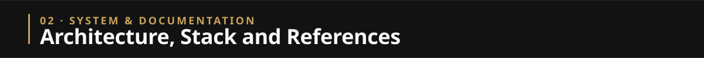
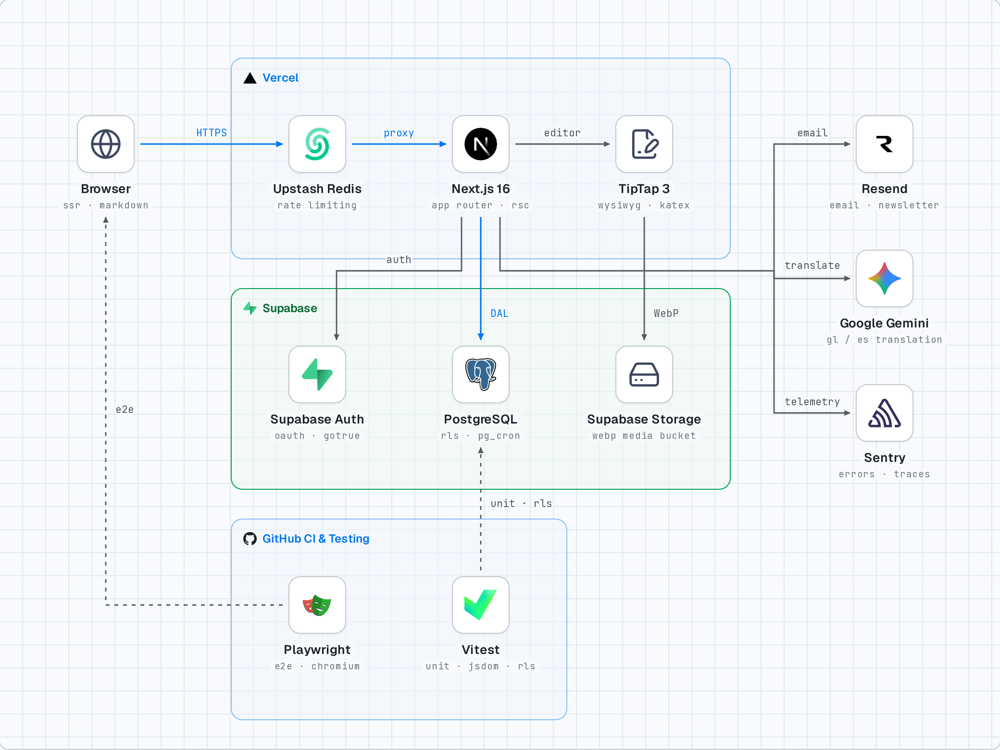

<p align="center">
  
</p>

<p align="center">
  <a href="https://cernapensamento.org"><strong>cernapensamento.org</strong></a> ·
  <a href="#architecture-and-flow">Architecture</a> ·
  <a href="#technical-documentation">Documentation</a> ·
  <a href="#contributing-and-local-development">Contributing</a> ·
  <a href="AGENTS.md">AGENTS.md</a>
</p>

<p align="center">
  <strong>Cerna Pensamento</strong> is an independent cultural association and a bilingual digital magazine (<strong>Galician <code>gl</code></strong> by default and <strong>Spanish <code>es</code></strong>) dedicated to essays, political philosophy, Austrian economics, social sciences, poetry, and narrative. This website is built as an <strong>open-source project</strong> to provide a calm space for reflection, thoughtful reading, and open debate welcoming community contributions.
</p>

---

<p align="center">
  
</p>

| Editorial Pillar | Technical Implementation |
| :--- | :--- |
| **Editorial Reading & Accessibility** | Classic typography (`Libre Caslon Text` and `Source Sans 3`), dark mode with semantic tokens (`parchment`, `charcoal`, `gold`), scroll-synced table of contents, **KaTeX** math rendering, and CDN-cached **PDF** downloads. |
| **TipTap 3 Desk & Sanitization** | WYSIWYG editor for essays and articles with LaTeX formulas, contextual table controls, captioned figures compressed in-browser to **WebP**, and strict server sanitization via `sanitizeArticleHtml`. |
| **Full Bilingualism & AI Translation** | Full dictionary parity (`src/dictionaries/gl.json` and `es.json`), multilingual JSONB database fields, and direct editorial translation powered by **Google Gemini (`gemini-3.5-flash-lite`)**. |
| **Role-Based Workflow & Newsletter** | JWT and RLS role-based access control (`reader`, `guest`, `member`, `founder`, `admin`), draft quotas, client-side editorial review (preserving ISR), and batched newsletter dispatch via **`pg_net`**, **`pg_cron`**, and **Resend**. |

---

<p align="center">
  
</p>

## Architecture and Flow

<p align="center">
  
</p>

1. **Edge Perimeter (`src/proxy.ts`):** Detects and enforces the locale prefix (`gl` / `es`), normalizes route aliases (`/about`, `/privacy`, `/contact`), serves `Accept: text/markdown` negotiation via `/api/markdown`, bypasses redirects for `/llms.txt` and `/agent-instructions.md`, and enforces sliding-window rate limiting with **Upstash Redis** (`10 req/min` on `/api/*` excluding webhooks; `30 req/min` on mutations).
2. **Cookie-Free Public Reading (`src/app/[lang]/articulo/[slug]/page.tsx`):** Preserves `revalidate = 60` (ISR) by avoiding server-side `cookies()` reads and runs the strict pipeline `stripIndex` → `renderMathInHtml` → `renderHeadingAnchors` → `sanitizeArticleHtml`.
3. **Data, Auth & Newsletter (`PostgreSQL` + `Supabase`):** Approved publications (`published`) trigger a database hook that queues a **Vault**-signed `pg_net` webhook to `/api/webhooks/newsletter`, with bounded retries (5 exponential backoff attempts in `pg_cron`), 100-recipient batch delivery via **React Email + Resend**, and **RFC 8058** one-click unsubscribe.

### Tech Stack

| Layer | Technology | Details |
| :--- | :--- | :--- |
| **Framework & UI** | Next.js `16.2`, React `19.2`, TypeScript `5` | App Router with localized `app/[lang]/` routes, `strict` mode, React Server Components |
| **Styling & Typography** | Tailwind CSS `v4`, `next/font/google` | `Libre Caslon Text`, `Source Sans 3`, `Plus Jakarta Sans`, and `parchment` / `surface` / `gold` tokens |
| **Database & Auth** | Supabase PostgreSQL, `@supabase/ssr` | RLS, `custom_access_token_hook`, `media` WebP Storage, `pg_net`, `pg_cron`, and pgTAP |
| **Editor & Content** | TipTap `3.27`, KaTeX `0.16`, `sanitize-html`, `pdf-lib` | Math formulas, tables, WebP figures, TOC index, and PDF generator |
| **Security & Edge** | `src/proxy.ts`, `@upstash/ratelimit` | Dual Redis rate limiting, route protection, and HMAC-SHA256 tokens |
| **AI, Email & Observability** | `@google/genai`, `resend`, `@react-email/components`, `@sentry/nextjs` | `gemini-3.5-flash-lite`, transactional/newsletter email, and error telemetry |
| **Testing & CI** | Vitest `3.2`, Playwright `1.61`, `act` | Unit, component, local Supabase RLS, and E2E tests |

### System Topology

<p align="center">
  <a href="docs/stack-diagram.html">
    <picture>
      <source media="(prefers-color-scheme: dark)" srcset="assets/readme/stack-diagram-dark.png" />
      <source media="(prefers-color-scheme: light)" srcset="assets/readme/stack-diagram.png" />
      
    </picture>
  </a>
</p>

<p align="center">
  <sub>Interactive self-contained version: <a href="docs/stack-diagram.html"><code>docs/stack-diagram.html</code></a></sub>
</p>

## Technical Documentation

All technical documentation lives directly under [`docs/`](docs/INDEX.md), while operational protocols and Git/release workflows are centralized in [`AGENTS.md`](AGENTS.md):

| Document | Contents |
| :--- | :--- |
| [`docs/INDEX.md`](docs/INDEX.md) | System overview, entry points, and full repository tree |
| [`docs/frontend.md`](docs/frontend.md) | `[lang]` App Router, layouts, routes, design tokens, components, and i18n |
| [`docs/editor.md`](docs/editor.md) | TipTap 3 suite, KaTeX, tables, figures, `ARTICLE_SANITIZER_CONFIG`, and PDF export |
| [`docs/backend.md`](docs/backend.md) | Edge middleware (`src/proxy.ts`), rate limiting, 6 Route Handlers, and Server Actions |
| [`docs/database.md`](docs/database.md) | Relational schema, RLS, `newsletter_dispatches` retries, DAL (`src/lib/db/`), and Storage |
| [`docs/integrations.md`](docs/integrations.md) | Supabase Auth/Vault, Upstash Redis, Resend, Gemini AI, Sentry, `llms.txt`, and environment variables |
| [`docs/stack-diagram.html`](docs/stack-diagram.html) | Self-contained system topology diagram (light &amp; dark themes) |
| [`AGENTS.md`](AGENTS.md) | Critical development rules, isolated worktrees, commit protocol, and release checklist |

> **Local interactive diagram:** If you generate `docs/architecture.html` locally using the `archify` skill, it remains excluded in `.gitignore` so generated artifacts are never committed to the repository.

### Repository Structure

```text
cerna/
├── AGENTS.md                 # Agent protocol, critical rules, git worktrees, and release checklist
├── assets/readme/            # Visual assets (hero.png + source/, pure SVGs) for this README
├── database/full_schema.sql  # Canonical PostgreSQL schema dump and RLS policies
├── docs/                     # Technical documentation (INDEX, frontend, editor, backend, database, integrations)
├── public/                   # llms.txt, agent-instructions.md, logos, and static images
├── src/
│   ├── proxy.ts              # Edge middleware (i18n, aliases, rate limits, auth gate, Markdown negotiation)
│   ├── actions/              # Server Actions (articles.ts, auth.ts)
│   ├── app/
│   │   ├── [lang]/           # Localized pages (home, archive, reader, desk, authors, association)
│   │   ├── api/              # Route Handlers (pdf, markdown, contact, translate, webhooks/newsletter, unsubscribe)
│   │   └── auth/             # OAuth callbacks (/callback) and OTP verification (/confirm)
│   ├── components/           # Domain components (escritorio, features, forms, layout, sections, ui)
│   ├── dictionaries/         # Canonical dictionaries gl.json and es.json
│   └── lib/                  # DAL (db/), extensions & sanitizer (editor/), email/, pdf/, storage/, supabase/
└── supabase/
    ├── migrations/           # Timestamped incremental SQL migrations
    ├── seed.sql              # Sample data and seed accounts for local development
    └── tests/                # pgTAP database and newsletter_dispatch test suite
```

---

<p align="center">
  
</p>

## Contributing and Local Development

This repository is open to community contributions: design and accessibility improvements, dictionary translations (`gl.json` / `es.json`), bug fixes, or new editorial features.

### How to Contribute

1. **Fork** the repository and create a new branch from `development` (`git checkout -b feat/your-improvement development`).
2. Deploy the system locally following the steps below to test your changes in a real environment.
3. Follow the project conventions (full `gl`/`es` bilingualism with no hardcoded strings, security rules, and style guidelines described in [`AGENTS.md`](AGENTS.md)).
4. Before opening a **Pull Request** against `development`, verify that `npm run lint`, `npm test`, and `npm run build` pass without errors.

### Prerequisites

- **Node.js 20+** and **npm**
- **Docker** (required by the local Supabase CLI stack and for running local CI with `act`)
- External service keys depending on the features you need to test

### Installation and Local Stack

1. **Clone and install dependencies:**
   ```bash
   git clone https://github.com/cernapensamento/cernapensamento-webpage.git
   cd cernapensamento-webpage
   npm install
   ```

2. **Start the local Supabase stack and load seed data:**
   ```bash
   npm run db:start   # Starts PostgreSQL, GoTrue Auth, Storage, Studio (54323), and Inbucket (54324)
   npm run db:reset   # Applies all supabase/migrations/ and loads supabase/seed.sql
   ```

3. **Configure `.env.local`:**
   Copy the local keys printed by `npm run db:status` along with credentials for integrated services (see the full table in [`docs/integrations.md`](docs/integrations.md)):

   | Variable | Required locally | Purpose |
   | :--- | :--- | :--- |
   | `NEXT_PUBLIC_SUPABASE_URL` | Yes | Supabase API URL (`http://127.0.0.1:54321` locally) |
   | `NEXT_PUBLIC_SUPABASE_ANON_KEY` | Yes | Public anon key governed by RLS policies |
   | `SUPABASE_SERVICE_ROLE_KEY` | For webhooks / RPC | Privileged key for newsletter dispatch and admin RPCs |
   | `NEXT_PUBLIC_SITE_URL` | Yes | Canonical base URL (`http://localhost:3000` locally) |
   | `UPSTASH_REDIS_REST_URL` / `TOKEN` | Optional in dev | Edge rate limiting (`src/proxy.ts`) |
   | `GEMINI_API_KEY` | For `/api/translate` | Automatic `gl` ↔ `es` translation in the desk |
   | `RESEND_API_KEY`, `CONTACT_*`, `WEBHOOK_SECRET`, `UNSUBSCRIBE_TOKEN_SECRET` | For email / webhooks | `/api/contact` form, newsletter batches, and RFC 8058 HMAC unsubscribe |

4. **Start the development server:**
   ```bash
   npm run dev
   ```

### Local Endpoints and Test Accounts

- **Web application:** `http://localhost:3000`
- **Supabase Studio:** `http://127.0.0.1:54323` · **Inbucket (local email inbox):** `http://127.0.0.1:54324`

Running `npm run db:reset` creates preconfigured accounts from `supabase/seed.sql` (shared password: **`Password123!`**):

| Role | Seed Accounts |
| :--- | :--- |
| **`founder`** | `diegoaraujo@cernapensamento.org`, `hectorgonzalez@cernapensamento.org`, `denisfernandez@cernapensamento.org`, `anxoperez@cernapensamento.org` |
| **`admin`** | `admin@cernapensamento.org` |
| **`guest`** | `lucia.vazquez@cerna.org` |
| **`member`** | `martino.rodriguez@cerna.org` |
| **`reader`** | `lector@cerna.org` |

### Available Scripts

| Command | Description |
| :--- | :--- |
| `npm run dev` | Starts Next.js in development mode |
| `npm run build` / `npm start` | Builds for production and starts the server |
| `npm run lint` | Runs ESLint (`eslint 9`) across the project |
| `npm test` / `npm run test:watch` | Unit and component test suite with Vitest |
| `npm run test:coverage` | `v8` coverage report with Vitest |
| `npm run test:db` | RLS integration tests against local Supabase (`RUN_DB_TESTS=1`) |
| `npx supabase test db` | pgTAP database and `newsletter_dispatches` tests |
| `npm run test:e2e` | End-to-End tests with Playwright |
| `npm run db:start` / `stop` / `reset` / `status` | Full management of the local Supabase Docker stack |
| `npm run act:check` / `act:test` / `act:pr` | Local validation of GitHub Actions workflows using `act` |
