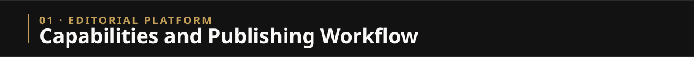
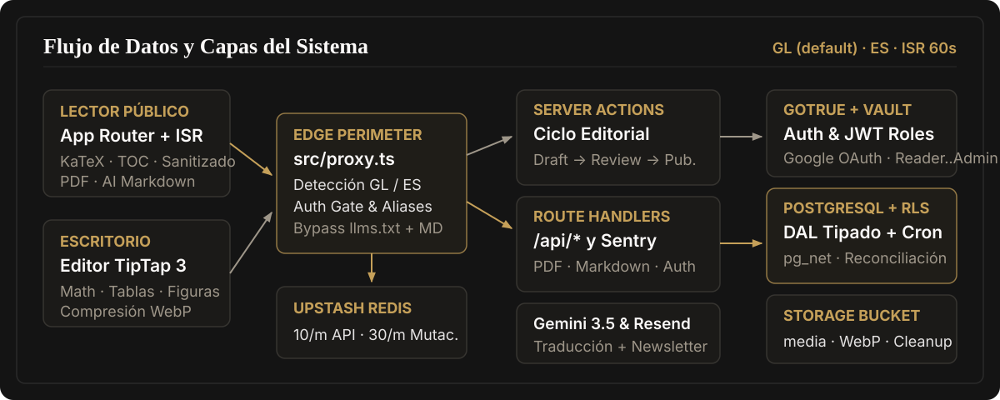

<p align="center">
  
</p>

<p align="center">
  <a href="https://cernapensamento.org"><strong>cernapensamento.org</strong></a> ·
  <a href="#arquitectura-e-fluxo">Arquitectura</a> ·
  <a href="#documentacion-tecnica">Documentación</a> ·
  <a href="#posta-en-marcha-local">Posta en Marcha</a> ·
  <a href="AGENTS.md">AGENTS.md</a>
</p>

<p align="center">
  <strong>Cerna Pensamento</strong> é unha revista cultural dixital e plataforma editorial bilingüe (<strong>galego <code>gl</code></strong> por defecto e <strong>castelán <code>es</code></strong>) dedicada ao ensaio, á filosofía política, á economía austríaca, á poesía e á narrativa. Combina lectura literaria con caché ISR, edición avanzada en TipTap 3, tradución asistida por IA, exportación PDF e boletíns automatizados desde PostgreSQL.
</p>

---

<p align="center">
  
</p>

| Piar Editorial | Implementación Técnica |
| :--- | :--- |
| **Lectura Editorial & Accesibilidade** | Tipografía clásica (`Libre Caslon Text` e `Source Sans 3`), modo escuro con tokens semánticos (`parchment`, `charcoal`, `gold`), índice automático sincronizado co scroll, renderizado matemático **KaTeX** e descarga en **PDF** con caché CDN. |
| **Escritorio TipTap 3 & Sanitización** | Editor WYSIWYG para ensaios e artigos con fórmulas LaTeX, táboas con controis contextuais, figuras con pé de foto comprimidas no navegador a **WebP** e dobre canalización estrita mediante `sanitizeArticleHtml`. |
| **Bilingüismo Integral & Tradución IA** | Paridade completa de dicionarios (`src/dictionaries/gl.json` e `es.json`), campos JSONB multilingües na base de datos e tradución directa no escritorio mediante **Google Gemini (`gemini-3.5-flash-lite`)**. |
| **Workflow por Roles & Newsletter** | Control de acceso por roles en JWT e RLS (`reader`, `guest`, `member`, `founder`, `admin`), cotas de borrador, revisión editorial no cliente (sen romper o ISR) e envío automatizado por lotes con **`pg_net`**, **`pg_cron`** e **Resend**. |

---

<p align="center">
  
</p>

## Arquitectura e Fluxo

<p align="center">
  
</p>

1. **Perímetro Edge (`src/proxy.ts`):** Detecta e forza o prefixo de idioma (`gl` / `es`), normaliza aliases (`/about`, `/privacy`, `/contact`), serve negociación `Accept: text/markdown` cara a `/api/markdown`, exclúe `/llms.txt` e `/agent-instructions.md` de redireccións e aplica rate limiting deslizante en **Upstash Redis** (`10 req/min` en `/api/*` agás webhooks; `30 req/min` en mutacións).
2. **Lectura pública sen cookies (`src/app/[lang]/articulo/[slug]/page.tsx`):** Mantén `revalidate = 60` (ISR) ao non ler `cookies()` no servidor e executa a cadea estrita `stripIndex` → `renderMathInHtml` → `renderHeadingAnchors` → `sanitizeArticleHtml`.
3. **Datos, Auth e Newsletter (`PostgreSQL` + `Supabase`):** As publicacións aprobadas (`published`) disparan un trigger que encola un webhook asinado vía **Vault** e `pg_net` cara a `/api/webhooks/newsletter`, con reintentos limitados (5 intentos con backoff exponencial en `pg_cron`), envío por lotes de 100 destinatarios con **React Email + Resend** e baixa 1-click conforme a **RFC 8058**.

### Stack Tecnolóxico

| Capa | Tecnoloxía | Detalles |
| :--- | :--- | :--- |
| **Framework & UI** | Next.js `16.2`, React `19.2`, TypeScript `5` | App Router con rutas localizadas `app/[lang]/`, `strict` mode, React Server Components |
| **Estilos & Tipografía** | Tailwind CSS `v4`, `next/font/google` | `Libre Caslon Text`, `Source Sans 3`, `Plus Jakarta Sans` e tokens `parchment` / `surface` / `gold` |
| **Base de Datos & Auth** | Supabase PostgreSQL, `@supabase/ssr` | RLS, `custom_access_token_hook`, Storage `media` WebP, `pg_net`, `pg_cron` e pgTAP |
| **Editor & Contido** | TipTap `3.27`, KaTeX `0.16`, `sanitize-html`, `pdf-lib` | Fórmulas matemáticas, táboas, figuras WebP, índice TOC e xerador PDF |
| **Seguridade & Edge** | `src/proxy.ts`, `@upstash/ratelimit` | Rate limiting dual con Redis, protección de rutas e tokens HMAC-SHA256 |
| **IA, Correo & Observ.** | `@google/genai`, `resend`, `@react-email/components`, `@sentry/nextjs` | `gemini-3.5-flash-lite`, envío transaccional/newsletter e telemetría |
| **Testing & CI** | Vitest `3.2`, Playwright `1.61`, `act` | Tests unitarios, compoñentes, RLS en Supabase local e E2E |

## Documentacion Tecnica

Toda a documentación técnica colga directamente de [`docs/`](docs/INDEX.md), mantendo protocolos operativos e fluxos de Git/entrega centralizados en [`AGENTS.md`](AGENTS.md):

| Documento | Contido |
| :--- | :--- |
| [`docs/INDEX.md`](docs/INDEX.md) | Visión xeral, puntos de entrada e árbore completa do repositorio |
| [`docs/frontend.md`](docs/frontend.md) | App Router `[lang]`, layouts, rutas, tokens de deseño, compoñentes e i18n |
| [`docs/editor.md`](docs/editor.md) | Suite TipTap 3, KaTeX, táboas, figuras, `ARTICLE_SANITIZER_CONFIG` e exportación PDF |
| [`docs/backend.md`](docs/backend.md) | Edge middleware (`src/proxy.ts`), rate limiting, 6 Route Handlers e Server Actions |
| [`docs/database.md`](docs/database.md) | Esquema relacional, RLS, retry de `newsletter_dispatches`, DAL (`src/lib/db/`) e Storage |
| [`docs/integrations.md`](docs/integrations.md) | Supabase Auth/Vault, Upstash Redis, Resend, Gemini AI, Sentry, `llms.txt` e variables de contorno |
| [`AGENTS.md`](AGENTS.md) | Regras críticas de desenvolvemento, worktrees illados, protocolo de commits e releases |

> **Diagrama interactivo local:** Se xeras `docs/architecture.html` localmente coa skill `archify`, permanece excluído en `.gitignore` para non subir artefactos xerados ao repositorio.

### Estrutura do Repositorio

```text
cerna/
├── AGENTS.md                 # Protocolo de axentes, regras críticas, git worktrees e release checklist
├── assets/readme/            # Recursos visuais (hero.png + source/, SVG puros) para este README
├── database/full_schema.sql  # Volcado canónico do esquema PostgreSQL e políticas RLS
├── docs/                     # Documentación técnica (INDEX, frontend, editor, backend, database, integrations)
├── public/                   # llms.txt, agent-instructions.md, logotipos e imaxes estáticas
├── src/
│   ├── proxy.ts              # Middleware Edge (i18n, aliases, rate limits, auth gate, Markdown negotiation)
│   ├── actions/              # Server Actions (articles.ts, auth.ts)
│   ├── app/
│   │   ├── [lang]/           # Páxinas localizadas (inicio, arquivo, lector, escritorio, autores, asociación)
│   │   ├── api/              # Route Handlers (pdf, markdown, contact, translate, webhooks/newsletter, unsubscribe)
│   │   └── auth/             # Callbacks OAuth (/callback) e verificación OTP (/confirm)
│   ├── components/           # Compoñentes por dominio (escritorio, features, forms, layout, sections, ui)
│   ├── dictionaries/         # Dicionarios canónicos gl.json e es.json
│   └── lib/                  # DAL (db/), extensións e sanitizer (editor/), email/, pdf/, storage/, supabase/
└── supabase/
    ├── migrations/           # Migracións SQL incrementais ordenadas por timestamp
    ├── seed.sql              # Datos de proba e contas iniciais para desenvolvemento local
    └── tests/                # Suite pgTAP de base de datos e newsletter_dispatch
```

---

<p align="center">
  
</p>

## Posta en Marcha Local

### Requisitos Previos

- **Node.js 20+** e **npm**
- **Docker** (requirido polo stack local de Supabase CLI e para executar CI local con `act`)
- Claves dos servizos externos segundo as funcionalidades que precises probar

### Instalación e Stack Local

1. **Clonar e instalar dependencias:**
   ```bash
   git clone https://github.com/cernapensamento/cernapensamento-webpage.git
   cd cernapensamento-webpage
   npm install
   ```

2. **Arrincar o stack local de Supabase e cargar datos iniciais:**
   ```bash
   npm run db:start   # Inicia PostgreSQL, GoTrue Auth, Storage, Studio (54323) e Inbucket (54324)
   npm run db:reset   # Aplica todas as supabase/migrations/ e carga supabase/seed.sql
   ```

3. **Configurar `.env.local`:**
   Copia as claves locais que imprime `npm run db:status` xunto coas credenciais dos servizos integrados (consulta a táboa completa en [`docs/integrations.md`](docs/integrations.md)):

   | Variable | Obrigatoria en local | Uso |
   | :--- | :--- | :--- |
   | `NEXT_PUBLIC_SUPABASE_URL` | Si | URL da API de Supabase (`http://127.0.0.1:54321` en local) |
   | `NEXT_PUBLIC_SUPABASE_ANON_KEY` | Si | Clave pública gobernada por políticas RLS |
   | `SUPABASE_SERVICE_ROLE_KEY` | Para webhooks / RPC | Servizo privilexiado para dispatch de newsletter e admin RPCs |
   | `NEXT_PUBLIC_SITE_URL` | Si | URL base canónica (`http://localhost:3000` en local) |
   | `UPSTASH_REDIS_REST_URL` / `TOKEN` | Opcional en dev | Rate limiting no perímetro Edge (`src/proxy.ts`) |
   | `GEMINI_API_KEY` | Para `/api/translate` | Tradución automática `gl` ↔ `es` no escritorio |
   | `RESEND_API_KEY`, `CONTACT_*`, `WEBHOOK_SECRET`, `UNSUBSCRIBE_TOKEN_SECRET` | Para correo / webhooks | Formulario `/api/contact`, lotes newsletter e baixa HMAC RFC 8058 |

4. **Iniciar o servidor de desenvolvemento:**
   ```bash
   npm run dev
   ```

### Endpoints Locais e Contas de Proba

- **Aplicación web:** `http://localhost:3000`
- **Supabase Studio:** `http://127.0.0.1:54323` · **Inbucket (bandexa de correo local):** `http://127.0.0.1:54324`

O script `npm run db:reset` crea contas preconfiguradas en `supabase/seed.sql` (contrasinal común: **`Password123!`**):

| Rol | Contas Seed |
| :--- | :--- |
| **`founder`** | `diegoaraujo@cernapensamento.org`, `hectorgonzalez@cernapensamento.org`, `denisfernandez@cernapensamento.org`, `anxoperez@cernapensamento.org` |
| **`admin`** | `admin@cernapensamento.org` |
| **`guest`** | `lucia.vazquez@cerna.org` |
| **`member`** | `martino.rodriguez@cerna.org` |
| **`reader`** | `lector@cerna.org` |

### Scripts Dispoñibles

| Comando | Descrición |
| :--- | :--- |
| `npm run dev` | Arrinca Next.js en modo desenvolvemento |
| `npm run build` / `npm start` | Compila para produción e executa o servidor |
| `npm run lint` | Executa ESLint (`eslint 9`) sobre todo o proxecto |
| `npm test` / `npm run test:watch` | Suite unitaria e de compoñentes con Vitest |
| `npm run test:coverage` | Informe de cobertura `v8` con Vitest |
| `npm run test:db` | Probas de integración RLS contra Supabase local (`RUN_DB_TESTS=1`) |
| `npx supabase test db` | Probas pgTAP da base de datos e `newsletter_dispatches` |
| `npm run test:e2e` | Probas End-to-End con Playwright |
| `npm run db:start` / `stop` / `reset` / `status` | Xestión completa da pila Docker de Supabase local |
| `npm run act:check` / `act:test` / `act:pr` | Validación local de workflows de GitHub Actions con `act` |
