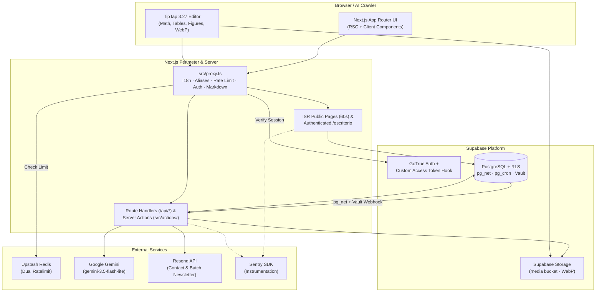

# Cerna Pensamento — Architecture Index

> **Status:** Active Reference · **Core Stack:** Next.js 16.2 (`App Router`), React 19.2, TypeScript 5 (`strict`), Tailwind CSS v4, Supabase (PostgreSQL + Auth + Storage), TipTap 3.27, Upstash Redis, Google Gemini (`gemini-3.5-flash-lite`), Resend, Sentry.

---

## 1. Platform Overview

**Cerna Pensamento** ([cernapensamento.org](https://cernapensamento.org)) is a bilingual (**Galician `gl` default** and **Spanish `es`**) digital cultural journal and essay magazine dedicated to political philosophy, Austrian economics, social sciences, literary criticism, poetry, and narrative.

The platform serves three primary audiences:
1. **Public Readers & AI Agents:** Server-rendered and ISR-cached literary reading experience (`revalidate = 60`), server-generated PDF editions (`pdf-lib`), dark/light editorial themes, interactive table of contents, KaTeX math typesetting, comments, and structured discovery endpoints (`/llms.txt`, `/agent-instructions.md`, `/api/markdown`).
2. **Contributors & Editorial Board (`guest`, `member`, `founder`, `admin`):** Authenticated desk (`/escritorio`) powered by a rich TipTap 3 WYSIWYG editor, bilingual Gemini translation assistant, WebP client-side image compression, publication quotas, and an editorial approval workflow (`draft` → `in_review` → `published` / `rejected`).
3. **Operations & Automated Dispatch:** Perimeter edge middleware (`src/proxy.ts`), Upstash Redis dual-tier rate limiting, Resend transactional email + batch newsletter dispatch via PostgreSQL `pg_net`/`pg_cron` retry bookkeeping (`newsletter_dispatches`), and Sentry error observability.

---

## 2. Documentation Map

All technical documentation lives directly under `docs/`:

| Document | Scope | Key Modules Covered |
| :--- | :--- | :--- |
| **[INDEX.md](INDEX.md)** | System overview, high-level architecture, and source layout | `src/`, `supabase/`, `public/` |
| **[frontend.md](frontend.md)** | App Router routes, layouts, design tokens, i18n, UI components | `src/app/[lang]/`, `src/components/`, `src/dictionaries/` |
| **[editor.md](editor.md)** | TipTap 3 extensions, KaTeX math, TOC anchors, HTML sanitizer, PDF export | `src/components/escritorio/`, `src/lib/editor/`, `src/lib/pdf/` |
| **[backend.md](backend.md)** | Edge middleware, rate limiting, API route handlers, Server Actions | `src/proxy.ts`, `src/app/api/`, `src/actions/` |
| **[database.md](database.md)** | PostgreSQL schema, RLS, quotas, newsletter cron retries, DAL, Storage | `database/full_schema.sql`, `supabase/`, `src/lib/db/`, `src/lib/storage/` |
| **[integrations.md](integrations.md)** | Supabase Auth/Vault, Upstash Redis, Resend, Gemini AI, Sentry, Agent Discovery | `src/app/api/`, `src/lib/email/`, `src/lib/agent/`, `public/` |

> **Local-only visualizer:** If generated locally, `docs/architecture.html` provides an interactive source-linked architecture diagram. It is intentionally git-ignored (`.gitignore`) and never committed to the repository.

---

## 3. High-Level Architecture



---

## 4. Repository Structure

```text
cerna/
├── AGENTS.md                       # Authoritative AI agent, git worktree & release protocols
├── README.md                       # Repository overview & quickstart
├── database/
│   └── full_schema.sql             # Canonical PostgreSQL schema dump
├── docs/                           # Technical documentation (INDEX, frontend, editor, backend, database, integrations)
├── public/
│   ├── agent-instructions.md       # Machine-readable site guide for AI agents
│   ├── llms.txt                    # LLM discovery index
│   └── images/                     # Brand logos, columnists & hero media
├── src/
│   ├── proxy.ts                    # Edge perimeter middleware (i18n, aliases, rate limits, auth, MD negotiation)
│   ├── i18n-config.ts              # Supported locales ('gl' default, 'es') & locale validation
│   ├── instrumentation.ts          # Next.js / Sentry server instrumentation hook
│   ├── instrumentation-client.ts   # Sentry browser instrumentation
│   ├── actions/                    # Server Actions: articles.ts, auth.ts
│   ├── app/
│   │   ├── [lang]/                 # Localized pages (home, articulos, articulo/[slug], asociacion, autor, escritorio, etc.)
│   │   ├── api/                    # Route Handlers: articulo/[slug]/pdf, contact, markdown, newsletter/unsubscribe, translate, webhooks/newsletter
│   │   ├── auth/                   # OAuth callback & OTP verification handlers (/callback, /confirm)
│   │   ├── robots.ts / sitemap.ts  # Dynamic SEO & discovery manifests
│   │   └── globals.css             # Tailwind v4 design tokens & typography variables
│   ├── components/
│   │   ├── escritorio/             # TipTap editor, toolbar, review bar, tag manager, table controls
│   │   ├── estatutos/              # Institutional statutes renderer
│   │   ├── features/               # Article reader TOC, download button, comments, author profile, archives
│   │   ├── forms/                  # Editorial submission, edit, contact, comment & password forms
│   │   ├── layout/                 # PublicNavBar, SideMenu, SiteFooter & visibility wrappers
│   │   ├── providers/              # AuthProvider, ThemeProvider, FeedbackProvider
│   │   ├── sections/               # Homepage sections (FeaturedHero, Pinned, Columnists, Themes, FAQ, etc.)
│   │   └── ui/                     # Shared primitives (ThemeToggle, LanguageToggle, MarkdownRenderer, Skeletons, etc.)
│   ├── content/                    # Markdown static documents (estatutos, privacidad, editorial collections in gl/es)
│   ├── dictionaries/               # Bilingual i18n dictionaries (gl.json, es.json) + server/client loaders
│   ├── hooks/                      # React hooks (useAuth, useLocale)
│   └── lib/
│       ├── agent/                  # Markdown serializer for AI negotiation (markdown.ts)
│       ├── db/                     # Strongly-typed DAL: schema.ts, types.ts, client.ts, queries/, __rls__/
│       ├── editor/                 # TipTap extensions, KaTeX renderer, heading anchors, HTML sanitizer, draft storage
│       ├── email/                  # React Email newsletter template, unsubscribe page & HMAC tokens
│       ├── i18n/                   # deepMerge, resolveLocalizedText & bilingual validation helpers
│       ├── pdf/                    # Server-side PDF builder (pdf-lib)
│       ├── storage/                # WebP compression, canonical path builders & orphan cleanup
│       └── supabase/               # SSR server.ts & browser client.ts Supabase clients
└── supabase/
    ├── config.toml                 # Local Supabase CLI stack configuration
    ├── migrations/                 # Timestamped incremental SQL migrations
    ├── seed.sql                    # Local seed data, sample publications & test accounts
    └── tests/                      # pgTAP database & newsletter dispatch SQL test suite
```
