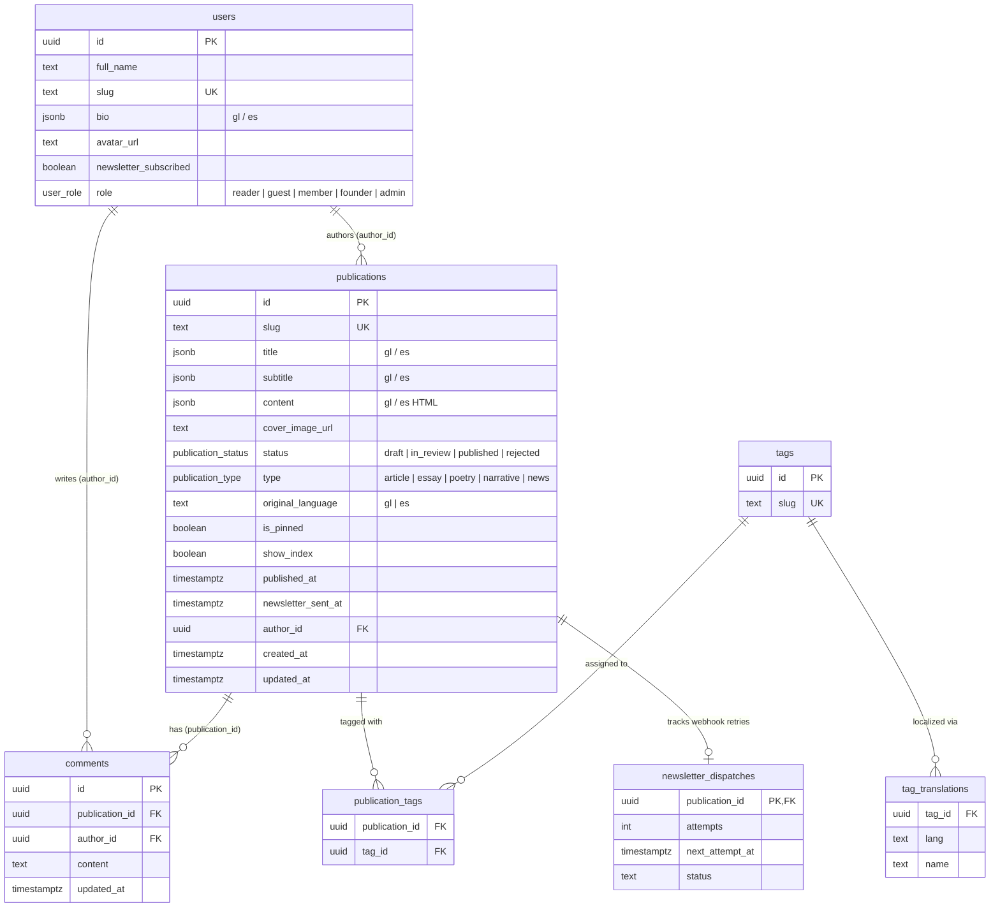

# Database, Data Access Layer & Storage

Cerna Pensamento uses **Supabase PostgreSQL** with Row Level Security (RLS), JWT custom role claims, PostgreSQL background dispatch automation (`pg_net` + `pg_cron` + Vault), a zero-magic-string TypeScript DAL (`src/lib/db/`), and compressed WebP asset management in Supabase Storage.

---

## 1. Canonical Relational Schema (`database/full_schema.sql`)



### Core PostgreSQL Functions & Triggers
- **`custom_access_token_hook()`:** Injects the authenticated user's `user_role` from `users` into the JWT claims so RLS and edge checks can inspect `current_user_role()` efficiently.
- **`is_operator()` / `is_writer()`:** Reusable SQL security helpers separating editorial operators (`founder`, `admin`) from general contributors (`guest`, `member`).
- **`check_publication_quotas()`:** Database-level trigger/guardrail enforcing `GUEST_PUBLICATION_LIMITS` so guest accounts cannot exceed draft/review submission quotas.
- **`set_publication_published_at()`:** Sets `published_at` deterministically when a publication transitions to `published`.
- **`unsubscribe_newsletter_by_email()` / `get_subscribers_emails()`:** Controlled RPC entry points backing `/api/newsletter/unsubscribe` and `/api/webhooks/newsletter`.

---

## 2. Newsletter Dispatch Retry Bookkeeping (`pg_net` & `pg_cron`)

Automatic newsletter delivery on publication transition is driven directly from PostgreSQL without external message queues:

1. **Initial Dispatch:** When a publication transitions to `published`, `trigger_publication_published_newsletter` fires `dispatch_newsletter_webhook()`, queuing an HTTP `POST` via `pg_net` to `/api/webhooks/newsletter` using the webhook secret stored in Supabase **Vault** (falling back to runtime configuration).
2. **Bounded Exponential Backoff (`reconcile_newsletter_dispatches()`):**
   - Scheduled via `pg_cron` once per minute (`* * * * *`), inspecting pending rows in batches of `100`.
   - Retries failed or unconfirmed deliveries up to **5 attempts** with exponential delays (`1`, `2`, `4`, `8` minute waits and a `16` minute final check).
   - Once `publications.newsletter_sent_at` is stamped by the webhook or max attempts expire, rows are finalized.
3. **Required PostgreSQL Runtime Settings & Testing:**
   - Local/remote execution relies on Vault secrets and runtime `app.settings.site_url` (HTTPS in production) / `app.settings.webhook_secret`.
   - Database trigger and retry logic are verified with pgTAP tests in `supabase/tests/newsletter_dispatch.test.sql`:
     ```bash
     npm run db:reset
     npx supabase test db
     ```
   - RLS integration tests live under `src/lib/db/__rls__/publications.rls.test.ts` and run via `npm run test:db` (`RUN_DB_TESTS=1`).

---

## 3. Typed Data Access Layer (`src/lib/db/`)

All application database reads and mutations go through the typed DAL rather than ad-hoc table strings:

| File | Responsibility |
| :--- | :--- |
| **`src/lib/db/schema.ts`** | Canonical constants: `DB_TABLES`, `PUBLICATION_COLS`, `USER_COLS`, `COMMENT_COLS`, `TAG_COLS`, `PUBLICATION_TAG_COLS`, `USER_ROLES`, `PUBLICATION_STATUSES`, `PUBLICATION_TYPES`, `GUEST_PUBLICATION_LIMITS`, `EDITOR_ACTIONS`. |
| **`src/lib/db/types.ts`** | Strict TypeScript row interfaces, join shapes, and bilingual view models. |
| **`src/lib/db/client.ts` & `formatDbError.ts`** | Shared Supabase DB query helpers and normalized PostgreSQL error formatting. |
| **`src/lib/db/queries/publications.ts`** | Publication CRUD, localized homepage/archive queries, pin/unpin, slug resolution. |
| **`src/lib/db/queries/users.ts`** | Author directory, profile lookup by slug, profile updates, contributor stats. |
| **`src/lib/db/queries/comments.ts`** | Publication comment queries and mutations. |
| **`src/lib/db/queries/tags.ts`** | Tag listing, localized `tag_translations`, and `publication_tags` assignment. |
| **`src/lib/db/queries/composite.ts`** | Compound page loaders combining homepage/dashboard/author views without over-fetching. |
| **`src/lib/db/queries/newsletter.ts`** | Atomic claim (`claimPublicationForNewsletter`), claim release, and subscriber RPC invocation. |

> **Egress Bandwidth Rule:** Listing queries (homepage, `/articulos`, `/noticias`, `/autores`, dashboard lists) **never** select `content`. Only metadata fields required by cards are fetched.

---

## 4. Storage Bucket & WebP Asset Pipeline (`src/lib/storage/`)

- **Primary Bucket:** `media` (with legacy `imagenes-articulos` and legacy folder prefixes kept compatible during transition until Ticket 07 contracts them).
- **Entity-Grouped Canonical Paths (`paths.ts`):**
  - **Avatars:** `users/{userId}/avatar-{timestamp}-{slug}.webp` (max `512x512`, `cover` fit)
  - **Covers:** `publications/{publicationId}/cover-{timestamp}-{slug}.webp` (max `1600x1200`, `inside` fit)
  - **Inline figures:** `publications/{publicationId}/inline/{name}-{timestamp}-{slug}.webp` (max `1400x1400`, `inside` fit)
  - **Legacy compatibility (until Ticket 07):** `profiles/{userId}/`, `publications/covers/{userId}/`, `publications/inline/{userId}/`, `avatares/`, `portadas/`, and `contenido/` remain recognized for cleanup and migration.
- **Hybrid Upload Pipeline (`POST /api/storage/upload` + `compress.ts`):**
  - The browser compresses images to WebP via `compressImageToWebP()` when canvas WebP encoding is supported, then uploads to `POST /api/storage/upload`.
  - The Route Handler enforces authentication, role/ownership checks (and publication editability for non-operators), validates magic bytes via `sharp`, passes already-valid in-bounds WebP through (requiring square dimensions for `cover`-fit avatars), and converts/resizes non-WebP, oversized, or uncropped payloads server-side before uploading to `media`.
- **Lazy Draft Creation:** Creating a new article in `/escritorio/nuevo` lazily persists a draft row on first cover or inline image upload so every publication asset is stored under its real `publications/{publicationId}/` folder.
- **Orphan Prevention (`deleteArticleAction`):** Deleting a publication sweeps the entire `publications/{publicationId}/` folder in `media` and also removes any remaining legacy cover/inline URLs via `cleanupPublicationImages()`.
- **Two-Phase Migration CLI (`scripts/migrate-storage.ts`):**
  - `node scripts/migrate-storage.ts migrate [--dry-run] [--manifest <path>]`: Copies legacy objects into entity-grouped `media` paths, applies database URL rewrites atomically in a single PostgreSQL transaction (requiring `DATABASE_URL`), verifies all migrated URLs over HTTP, and writes a manifest.
  - `node scripts/migrate-storage.ts cleanup --manifest <path>`: Re-verifies zero remaining legacy DB references before deleting superseded legacy objects and the empty `imagenes-articulos` bucket.
