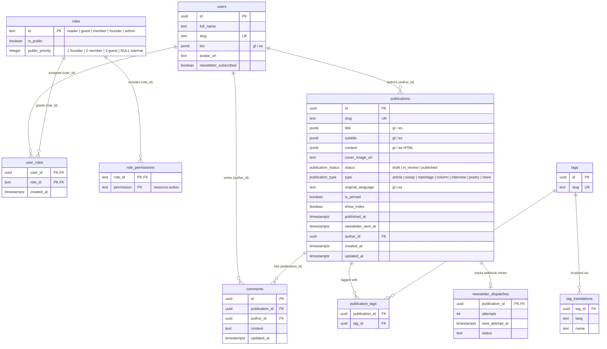

# Database, Data Access Layer & Storage

Cerna Pensamento uses **Supabase PostgreSQL** with Row Level Security (RLS), multi-role RBAC with atomic `resource:action` permissions (`has_permission()`), PostgreSQL background dispatch automation (`pg_net` + `pg_cron` + Vault), a zero-magic-string TypeScript DAL (`src/lib/db/`), and compressed WebP asset management in Supabase Storage.

---

## 1. Canonical Relational Schema (`database/full_schema.sql`)



### Multi-Role RBAC & Public Visibility (ADR 0003)
- **Catalog & Assignments:** `public.roles` defines canonical role slugs (`founder`, `member`, `guest`, `admin`, `reader`) with `is_public` (`true` for editorial roles `founder`, `member`, `guest`; `false` for `admin`, `reader`, and internal roles) and `public_priority` (`1`, `2`, `3`). `public.role_permissions` maps each role to the **19 atomic `resource:action` permissions** (`desk:access`, `ai:translate`, `publications:create`, `publications:update_own`, `publications:delete_own`, `publications:write_unlimited`, `publications:review`, `publications:publish`, `publications:pin`, `publications:update_any`, `publications:delete_any`, `media:upload_publication`, `media:delete_any`, `tags:create`, `tags:update`, `tags:delete`, `comments:delete_any`, `users:assign_role`, `users:revoke_role`). `public.user_roles` assigns multiple simultaneous roles per user.
- **Anonymous Visibility Boundary:** `anon` RLS on `roles` and `user_roles` exposes only `is_public = true` rows (`role_permissions` is denied to `anon`), ensuring internal roles such as `admin` or `reader` never leak publicly. Users with zero rows in `user_roles` fail closed to zero permissions.
- **Public `users` Column Grants:** `anon` has column-level `SELECT` exclusively on `(id, full_name, slug, bio, avatar_url)`.

### Publication Language Constraints (ADR 0001)
- Publications support both **Bilingual Publications** (`gl` + `es`) and **Monolingual Publications** (`gl`-only or `es`-only), derived from stored JSONB keys with no separate `language_mode` column (see `docs/adr/0001-monolingual-publications.md`).
- **`publications_language_content_check`:** For `published` and `in_review` rows, requires `original_language` to have both non-empty trimmed `title` and `content`, and requires any other populated supported locale to have both non-empty `title` and `content`. For `draft` rows, allows saving as long as at least one supported locale has non-empty `title` or `content`.
- **`publications_subtitle_jsonb_object_check`:** Allows `NULL`, `{}`, or any JSONB object subset of locales without forcing both `gl` and `es` keys.
- Verified via pgTAP in `supabase/tests/publication_language_constraints.test.sql` and RLS integration tests in `src/lib/db/__rls__/publications.rls.test.ts`.

### Core PostgreSQL Functions & Triggers
- **`has_permission(required_permission text)` / `is_public_role(target_role_id text)`:** `STABLE SECURITY DEFINER` SQL helpers (locked `search_path`) backing all table and `storage.objects` RLS policies directly against `user_roles` and `role_permissions`, so role grants and revocations take effect immediately without JWT expiry.
- **`handle_new_user()`:** Triggered on `auth.users` signup; creates the `public.users` profile row and assigns the baseline `'reader'` role in `public.user_roles`.
- **`check_publication_quotas()`:** Enforces `GUEST_PUBLICATION_LIMITS` (2 per calendar year, 4 total) whenever `NEW.author_id` lacks `publications:write_unlimited` in `user_roles` / `role_permissions`.
- **`enforce_publication_pin_permission()`:** Enforces `publications:pin` on `is_pinned` changes and blocks pin-only users from mutating non-pin publication fields.
- **`prevent_removing_last_admin()`:** Serialized via `pg_advisory_xact_lock` on `user_roles` to prevent deleting or mutating away the last remaining `admin` assignment.
- **`set_publication_published_at()`:** Sets `published_at` deterministically when a publication transitions to `published`.
- **`unsubscribe_newsletter_by_email()` / `get_subscribers_emails()`:** Controlled RPC entry points backing `/api/newsletter/unsubscribe` and `/api/webhooks/newsletter`.

---

## 2. Newsletter Dispatch Retry Bookkeeping (`pg_net` & `pg_cron`)

Automatic newsletter delivery on publication transition is driven directly from PostgreSQL without external message queues:

1. **Initial Dispatch:** When a publication transitions to `published`, `trigger_publication_published_newsletter` fires `dispatch_newsletter_webhook()`, queuing an HTTP `POST` via `pg_net` to `/api/webhooks/newsletter` using the webhook secret stored in Supabase **Vault** (falling back to runtime configuration).
2. **Bounded Exponential Backoff (`reconcile_newsletter_dispatches()`):**
   - Scheduled via `pg_cron` once per minute (`* * * * *`), inspecting pending rows in batches of `100`.
   - Retries failed or unconfirmed deliveries up to **5 attempts** with exponential delays (`1`, `2`, `4`, `8` minute waits and a `16` minute final check).
   - Once `publications.newsletter_sent_at` is stamped by the webhook or max attempts expire, rows are finalized.
3. **Required PostgreSQL Runtime Settings & Testing:**
   - Local/remote execution relies on Vault secrets and runtime `app.settings.site_url` (HTTPS in production) / `app.settings.webhook_secret`.
   - Database trigger, RBAC, and constraint logic are verified with pgTAP tests under `supabase/tests/` (`multi_role_rbac_expand.test.sql`, `multi_role_rbac_contract.test.sql`, `newsletter_dispatch.test.sql`, `publication_language_constraints.test.sql`, `published_at_trigger.test.sql`):
     ```bash
     npm run db:reset
     npx supabase test db
     ```
   - RLS integration tests live under `src/lib/db/__rls__/` (`rbac.rls.test.ts`, `publications.rls.test.ts`, `storage.rls.test.ts`) and run via `npm run test:db` (`RUN_DB_TESTS=1`).

---

## 3. Typed Data Access Layer (`src/lib/db/`)

All application database reads and mutations go through the typed DAL rather than ad-hoc table strings:

| File | Responsibility |
| :--- | :--- |
| **`src/lib/db/schema.ts`** | Canonical constants and pure RBAC helpers: `DB_TABLES`, `PUBLICATION_COLS`, `USER_COLS`, `COMMENT_COLS`, `TAG_COLS`, `PUBLICATION_TAG_COLS`, `ROLE_COLS`, `ROLE_PERMISSION_COLS`, `USER_ROLE_COLS`, `USER_ROLES`, `PERMISSIONS`, `ROLE_PERMISSIONS`, `PUBLIC_ROLE_PRIORITY`, `ROLE_METADATA`, `hasPermission`, `hasAnyPermission`, `hasAllPermissions`, `isGuestQuotaSubject`, `resolvePrimaryPublicRole`, `PUBLICATION_STATUSES`, `PUBLICATION_TYPES`, `GUEST_PUBLICATION_LIMITS`, `EDITOR_ACTIONS`. |
| **`src/lib/db/types.ts`** | Strict TypeScript row interfaces, RBAC permission/role types, join shapes, and bilingual view models. |
| **`src/lib/db/client.ts` & `formatDbError.ts`** | Shared Supabase DB query helpers and normalized PostgreSQL error formatting. |
| **`src/lib/db/queries/publications.ts`** | Publication CRUD, localized homepage/archive queries, pin/unpin, slug resolution. |
| **`src/lib/db/queries/users.ts`** | `getUserRolesAndPermissions`, `getColumnists` (`founder`-only via `user_roles`), `getPublishedAuthors` & `getAuthorProfileBySlug` (filtering `is_public` roles and resolving `publicRole` by `PUBLIC_ROLE_PRIORITY`), profile lookup, profile updates. |
| **`src/lib/db/queries/comments.ts`** | Publication comment queries and mutations. |
| **`src/lib/db/queries/tags.ts`** | Tag listing, localized `tag_translations`, and `publication_tags` assignment. |
| **`src/lib/db/queries/composite.ts`** | Compound page loaders combining homepage/dashboard/author views without over-fetching. |
| **`src/lib/db/queries/newsletter.ts`** | Atomic claim (`claimPublicationForNewsletter`), claim release, and subscriber RPC invocation. |

> **Egress Bandwidth Rule:** Listing queries (homepage, `/articulos`, `/noticias`, `/autores`, dashboard lists) **never** select `content`. Only metadata fields required by cards are fetched.

---

## 4. Storage Bucket & WebP Asset Pipeline (`src/lib/storage/`)

- **Primary Bucket:** `media` — public, `5 MiB` max file size, strictly locked to `allowed_mime_types = ['image/webp']` at the bucket level.
- **Entity-Grouped Canonical Paths (`paths.ts`):**
  - **Avatars:** `users/{userId}/avatar-{timestamp}-{slug}.webp` (max `512x512`, `cover` fit)
  - **Covers:** `publications/{publicationId}/cover-{timestamp}-{slug}.webp` (max `1600x1200`, `inside` fit)
  - **Inline figures:** `publications/{publicationId}/inline/{name}-{timestamp}-{slug}.webp` (max `1400x1400`, `inside` fit)
  - **Orphan quarantine:** `_orphans/*` (strictly Editorial Board operators and `service_role`)
- **Hybrid Upload Pipeline (`POST /api/storage/upload` + `compress.ts`):**
  - The browser compresses images to WebP via `compressImageToWebP()` when canvas WebP encoding is supported, then uploads to `POST /api/storage/upload`.
  - The Route Handler enforces authentication, role/ownership checks (and publication editability for non-operators), validates magic bytes via `sharp`, passes already-valid in-bounds WebP through (requiring square dimensions for `cover`-fit avatars), and converts/resizes non-WebP, oversized, or uncropped payloads server-side before uploading to `media`.
- **Lazy Draft Creation:** Creating a new article in `/escritorio/nuevo` lazily persists a draft row on first cover or inline image upload so every publication asset is stored under its real `publications/{publicationId}/` folder.
- **Whole-Folder Deletion Sweep (`deleteArticleAction`):** Deleting a publication sweeps the entire `publications/{publicationId}/` folder (cover + `inline/*`) in `media` via `sweepPublicationStorageFolder()` and removes any remaining owned references via `cleanupPublicationImages()`.
- **Two-Phase Migration CLI (`scripts/migrate-storage.ts`):**
  - Retained as a historical operator tool for migrating legacy buckets/hosts (`migrate` + `cleanup`) with self-contained legacy constants in `src/lib/storage/migration/`.
